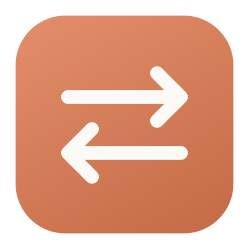
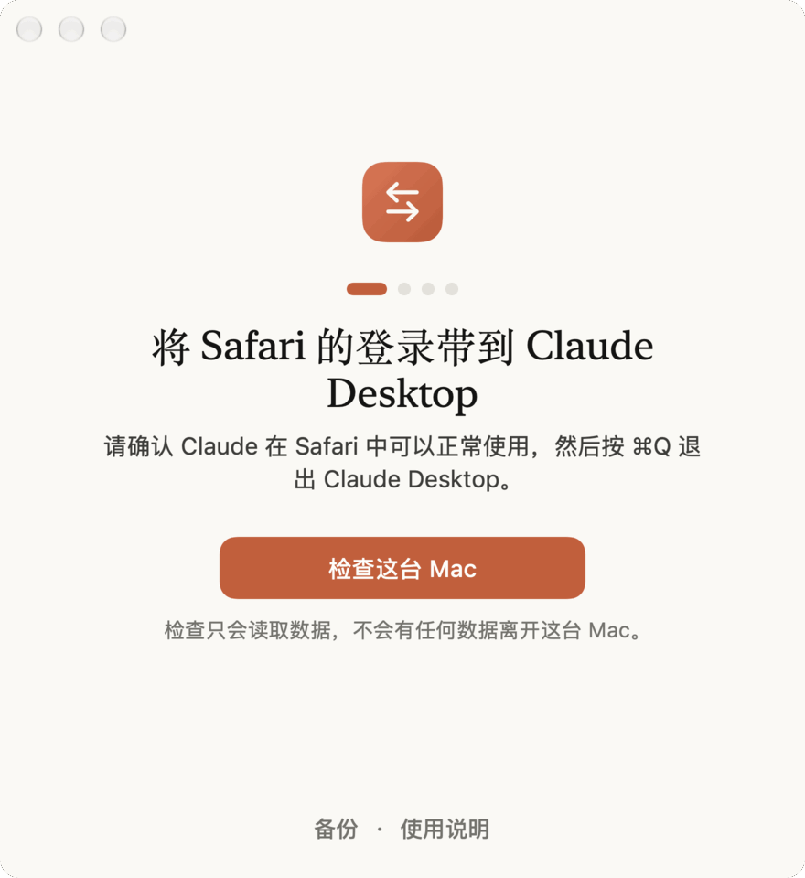

# Claude Sign-In Helper

**适用于 Safari 已登录 Claude、Mac 客户端却登录卡住的情况。**

将同一台 Mac 上 Safari 现有的 Claude 登录导入官方 Claude Desktop。所有处理都在本机完成，每次导入前自动备份。

[**下载 macOS 版本**](https://github.com/hibari233/claude-sign-in-helper/releases/latest)

[English](README.md)

macOS 13 Ventura 及以上 · Apple Silicon / Intel 通用版本 · MIT 开源

<picture>
  <source media="(prefers-color-scheme: dark)" srcset="docs/demo/walkthrough-zh-CN-dark.gif">
  
</picture>

## 使用前确认

- **Safari 中已经能正常使用 Claude**。工具只能迁移已有登录；如果所有设备都已退出，需要先完成正常登录。
- 使用同一台 Mac、同一个 macOS 用户账户，以及 **Safari 的默认个人资料**。目前不支持其他浏览器、其他 Safari 个人资料或多个 Claude 会话。
- 已安装[官方 Claude Desktop](https://claude.ai/download)，打开过至少一次，导入前用 **⌘Q** 完全退出。

例如，使用 Apple「隐藏邮件地址」后收不到桌面端的登录邮件，但 Safari 中仍能正常使用 Claude，就可以尝试这种本机迁移方式。

## 安装

1. 在 [Releases](https://github.com/hibari233/claude-sign-in-helper/releases/latest) 下载 `Claude-Sign-In-Helper-<版本>.zip`，解压后将 **Claude Sign-In Helper** 拖到「应用程序」。Intel 和 Apple Silicon 使用同一个下载包。
2. 当前预览版采用临时签名，**尚未经过 Apple 公证**。首次启动如被拦截，在「系统设置 → 隐私与安全性 → 安全性」中，为这个应用选择「仍要打开」。无需关闭 Gatekeeper；也可以[从源码构建](README.md#build-from-source)。

## 导入现有登录

1. 确认 Safari 中 Claude 能正常使用，并用 **⌘Q** 退出 Claude Desktop。
2. 打开辅助工具，选择 **检查这台 Mac**。检查只读取数据；如果 Desktop 已有登录，工具会保留它。
3. 选择 **导入登录…** 并确认。工具会先备份，再写入所需的 Claude Cookie。如果 macOS 询问是否允许访问 **Claude Safe Storage**，按提示选择「允许」；密码只在 macOS 自己的对话框中输入。
4. 选择 **打开 Claude**，待桌面端加载后，再选择 **确认登录**。最后检查 Claude 显示的是你预期的账户。

如果提示需要「完全磁盘访问权限」，这是因为 Safari 的 Cookie 文件受到 macOS 保护。确认信任工具后，在「系统设置 → 隐私与安全性 → 完全磁盘访问权限」中允许它，再退出并重新打开；用完可以关闭该权限。

「导入完成」与「登录已确认」是两个步骤。如果桌面端仍要求登录，可能是复制的会话已失效。先在 Safari 重新登录，再退出并重新打开辅助工具，重新检查；更多情况见[英文 FAQ](README.md#faq)。

## 隐私与恢复

- 工具不发起网络请求，不上传 Cookie，也不收集遥测。
- 只提取 Claude 所需的 Safari Cookie，并读取 Claude Desktop 的本地 Cookie 数据库、用于确认登录的本地日志，以及经 macOS 授权的钥匙串项。
- 写入范围是 Claude Desktop 数据库中的指定 Cookie。Safari 不会被修改，已有的 Desktop 登录不会被覆盖。
- 备份保存在本机，可在 **备份** 中尝试撤销导入。检测到会话已改变时，工具会停止恢复，避免替换更新的登录。

Cookie、钥匙串密钥和备份都属于敏感数据。反馈问题时只提供系统版本、操作步骤和脱敏错误信息；安全问题请按 [SECURITY.md](SECURITY.md) 私下报告。详细处理范围见[隐私与安全说明](README.md#privacy--safety)。

## 源码、测试与反馈

应用使用 SwiftUI 和 AppKit，没有第三方依赖。构建和自测命令见[从源码构建](README.md#build-from-source)。当前主分支包含 32 项使用虚构数据的自测，已在 arm64 和 x86_64（Rosetta）下通过。

社区贡献者还提供了 **M4 Pro / macOS 27** 的真实导入和钥匙串提示[实测报告](docs/testing/apple-silicon-m4-macos27.md)，其中记录了该环境的 SDK 构建问题和使用结果。其他机型、系统和 Claude 版本的反馈同样欢迎。

如果它帮你解决了登录问题，欢迎点个 Star，或在 [Issues](https://github.com/hibari233/claude-sign-in-helper/issues) 分享使用结果。参与开发或翻译请阅读 [CONTRIBUTING.md](CONTRIBUTING.md)。

本项目采用 [MIT 许可证](LICENSE)，是独立开源工具，与 Anthropic 或 Apple 没有关联，也未获其背书。
